# Resultats

Aquest document recull l’anàlisi dels resultats obtinguts al llarg del projecte sobre Flickr8k. Hem anat per fases: primer un **baseline** ResNet18+GRU entrenat des de zero, després un **fine-tuning** del model preentrenat ViT–GPT2, i finalment algunes **execucions addicionals** (debias de gènere i decoding alternatiu). El protocol de test concret de cada script està a [test.md](test.md); aquí comentem el que vam observar i com ho interpretem.

---

## 1. Baseline ResNet18 + GRU

### Configuració

Encoder ResNet18 (ImageNet): treiem la capa FC i quedem amb un vector de 512 dimensions per imatge. Decoder GRU de dues capes que genera la llegenda token a token; el vector d’imatge només inicialitza l’estat ocult.

Hiperparàmetres del run llarg: 30 èpoques, batch 32, Adam lr 2·10⁻⁴, hidden 256, char dim 512, seqüència màxima 30, teacher forcing 0,3, seed 42, `min_word_freq` 2. Vocabulari ~4623 tokens i ~15,8 M paràmetres (`train_baseline.py`). Entrenament amb PyTorch 2.6 + CUDA.

### Run `apricot-grass-11`

Les corbes estan a `docs/figures/` (`train_loss_11.png`, `val_loss_11.png`, `train_bleu_11.png`, `val_bleu_11.png`).

Abans de llegir-les: el BLEU de train a W&B **no** és sobre tot el dataset, sinó sobre els primers 10 batches (`bleu_subset` a `train_baseline.py`). El de validació sí passa per tot el loader. No té sentit comparar `train/bleu` amb `val/bleu` com si fossin la mateixa mesura.

**Pèrdua**

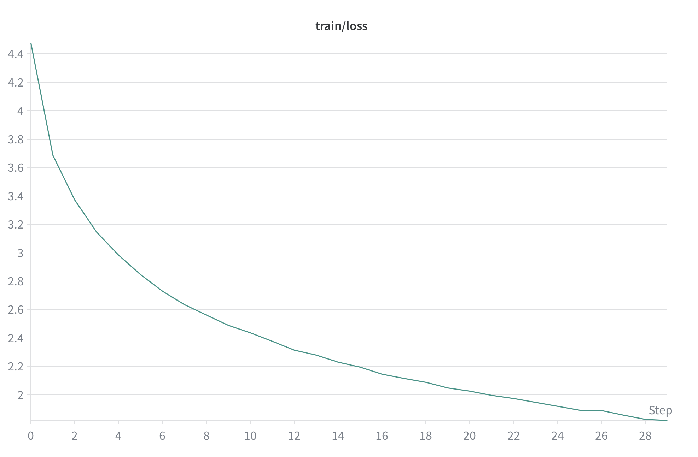

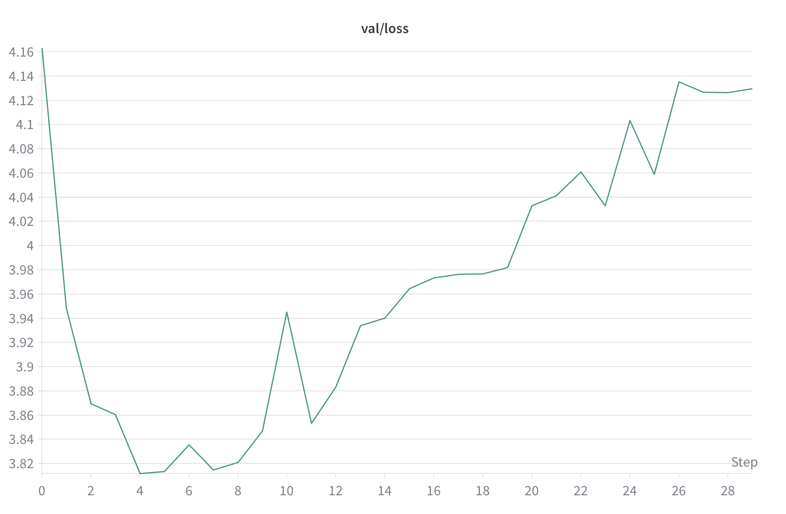

Al pas 29 el train loss queda ~1,82. La validació toca fons cap al pas 4 ( ~3,81, coincidint amb el millor checkpoint guardat) i després puja fins ~4,1 mentre el train segueix baixant. És el patró clàssic de sobreajustament.

**BLEU**

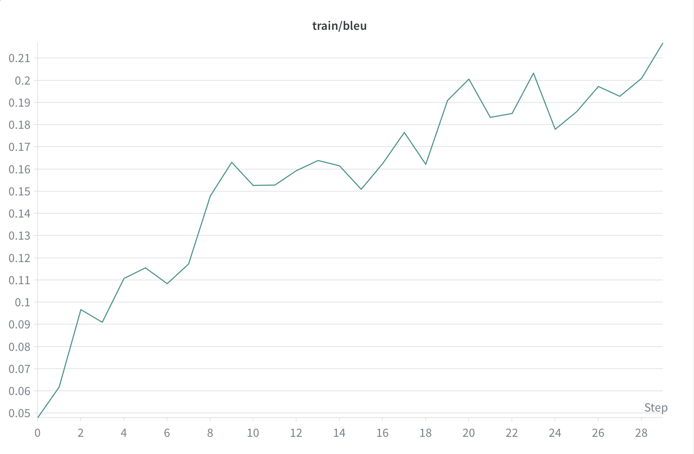

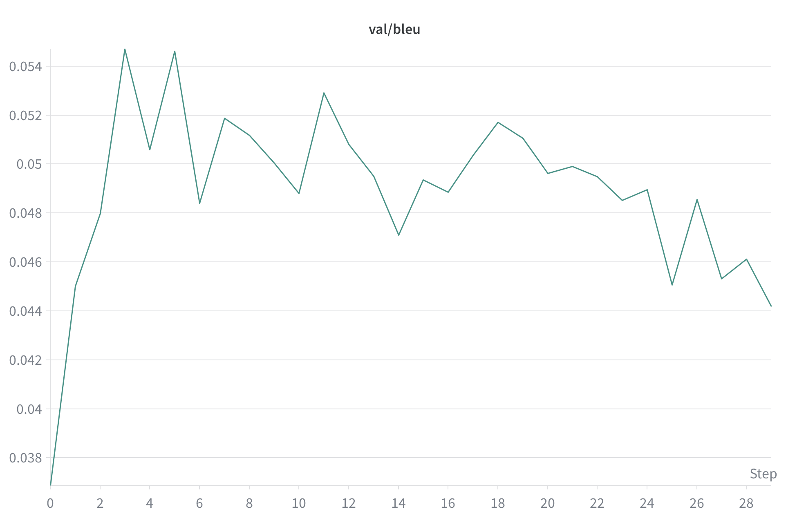

Al pas 29 el train BLEU (subconjunt) ronda 0,22; el val BLEU puja al principi (~0,055) i acaba més baix ( ~0,04), coherent amb el val loss pujant.

Resum al pas 29: train loss 1,82; train BLEU 0,22; val loss ~4,13; val BLEU ~0,04 (aquests dos últims llegits a ull des de les figures).

### Test (baseline)

Split test: 12,5 % final d’imatges (~1000 imatges, ~5060 files al `DataLoader` perquè hi ha 5 captions per imatge).

Amb `python test_baseline.py` i `checkpoints/best_model_baseline.pt`, amb el protocol antic (decoding greedy del baseline):

- **Test loss:** 3,7314  
- **Test BLEU (corpus):** 0,0553  

Més endavant vam repetir l’avaluació del baseline amb el **mateix protocol que el ViT** (beam, CLIPScore, BLEU corpus amb 5 referències); vegeu la taula comparativa a la §3.

El checkpoint guardat era de l’**epoch 4** (val loss ~3,81), no del pas 29 de les corbes. Les gràfiques mostren tot el run; el test reflecteix el punt on vam desar el millor model segons val loss.

### Exemples qualitatius (baseline)

Cinc imatges del test (miniatures a `docs/figures/predictions/`):

**559102835_472ff702b5.jpg**

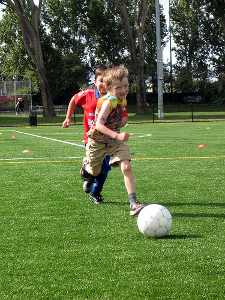

Predicció: *a boy in a red shirt is kicking a soccer ball .*  
Referència: *Two boys and a ball*

**408573233_1fff966798.jpg**

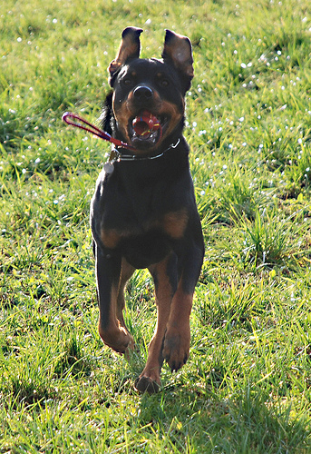

Predicció: *a black dog is a black dog in the grass .*  
Referència: *The black and brown dog is running with something in its mouth .*

**424416723_19c56cb365.jpg**

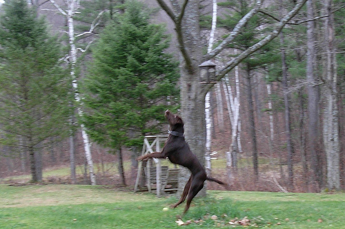

Predicció: *a dog is a a in the grass .*  
Referència: *A brown dog is jumping on its hind legs .*

**561179890_af8e31cb2e.jpg**

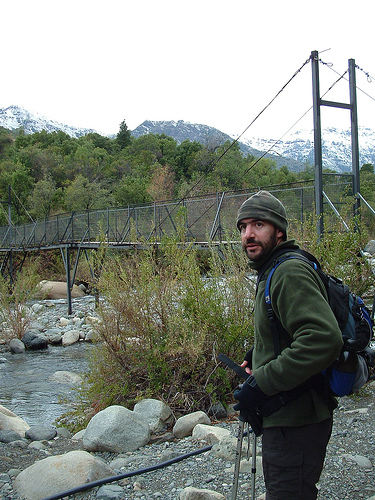

Predicció: *a man in a red shirt is walking on a city .*  
Referència: *A bearded man with a backpack on his back holding a tripod in front of a rocky creek and bridge .*

**500308355_f0c19067c0.jpg**

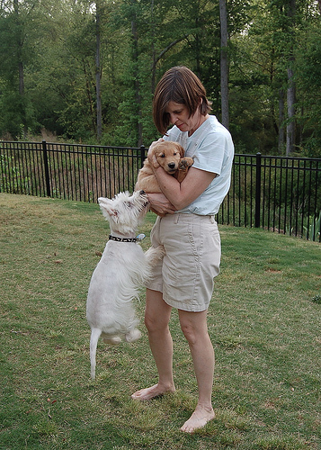

Predicció: *a woman in a white shirt is sitting on the grass .*  
Referència: *A white dog jumps at a woman holding another dog .*

### Lectura del baseline

El model captura temes freqüents (gent, gossos, exterior) però repeteix plantilles (*a X in a red shirt*, *in the grass*) i perd detall. Sense atenció, la imatge només entra al primer pas de la GRU; amb escenes amb diversos objectes acaba generalitzant o inventant. El BLEU baix i el sobreajustament precoç ens van fer buscar un model preentrenat amb més capacitat lingüística i visual.

---

## 2. Fine-tuning ViT–GPT2

### Per què vam canviar

Davant dels resultats del baseline, vam passar a `nlpconnect/vit-gpt2-image-captioning`: encoder ViT i decoder GPT-2 ja preentrenats, amb cross-attention entre imatge i text. Fem fine-tuning sobretot el decoder; l’encoder es descongela a partir d’una època concreta. Com a mètrica principal de validació vam triar **CLIPScore** (`val/clip_score`), no BLEU ni val loss, perquè reflecteix millor l’alineament semàntic imatge–text. Detalls d’arquitectura a [arquitectures.md](arquitectures.md).

### Sweep d’hiperparàmetres

Sweep bayesià a W&B (`sweep.yaml`, mètrica `val/clip_score` a maximitzar, Hyperband). Vam variar lr, weight decay, label smoothing, batch size, època de descongelar l’encoder, dropout del decoder, capes congelades del decoder i LLRD. Runs prevists de 30 èpoques; molts s’aturen abans per early stopping.

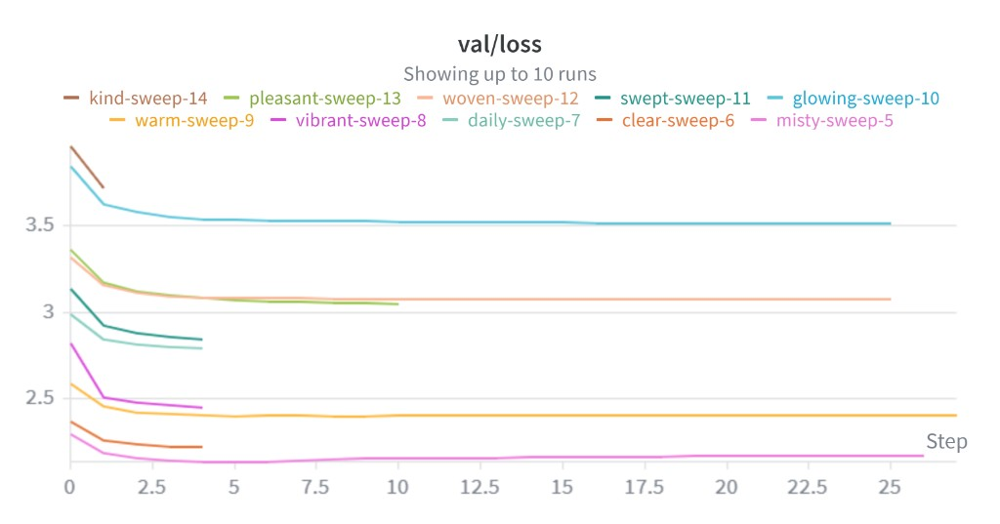

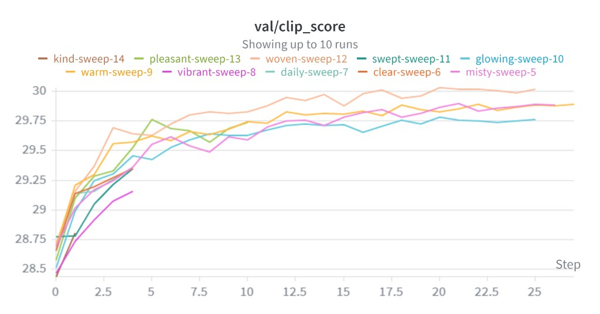

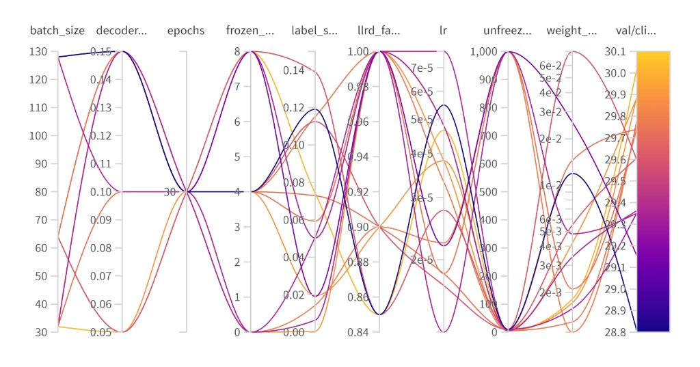

Què vam veure:

- Gairebé totes les configs baixen la loss molt ràpid als primers passos (0–5).
- La run amb **val loss més baixa** no és sempre la millor en CLIP.
- Cal triar hiperparàmetres mirant **`val/clip_score`**, no només val loss.

Amb ~10 trials del sweep les tendències són orientatives (batch 32, congelar capes del decoder, descongelar l’encoder a mitja training, etc.), però la combinació concreta la vam validar amb un **entrenament llarg** a part (següent secció).

### Entrenament amb els millors hiperparàmetres del sweep

Després del sweep vam llançar un entrenament normal (50 èpoques màx., early stopping) amb la config que ens havia funcionat millor. Paràmetres principals:

| Paràmetre | Valor |
|-----------|-------|
| batch_size | 32 |
| lr | 4,373·10⁻⁵ |
| weight_decay | 0,0223 |
| label_smoothing | 0,1047 |
| decoder_dropout | 0,2 |
| frozen_decoder_layers | 8 |
| unfreeze_encoder_epoch | 10 |
| warmup_epochs | 1 |
| early_stop_patience | 15 |
| epochs (màx.) | 50 |

~239 M paràmetres totals, ~77 M entrenables (W&B). El checkpoint `best_model.pt` es guarda quan millora `val/clip_score`.

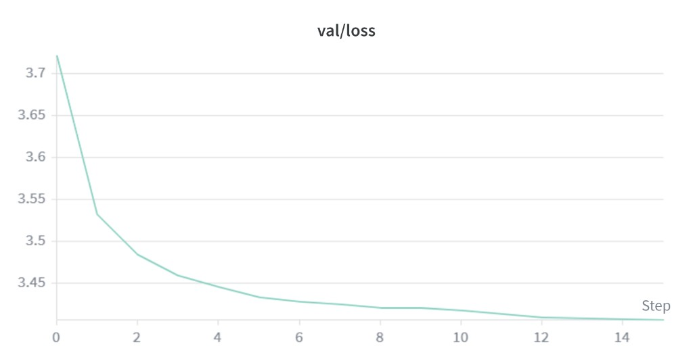

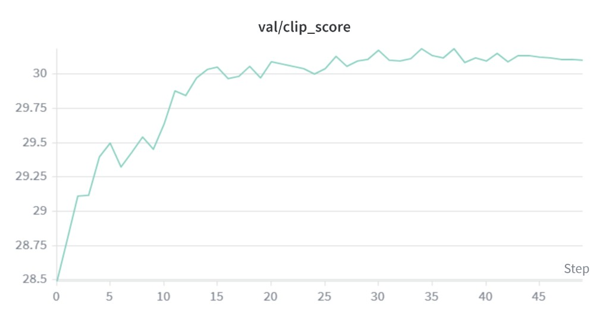

**Val loss:** comença ~3,72 i baixa molt de pressa (ja ~3,53 a l’època 1). Després continua baixant de forma més lenta fins estabilitzar-se al voltant de ~ 3,41 a validació.

**Val CLIPScore:** puja de ~28,5 fins superar 30 cap a mitja training; els pics més alts ronden ~30,18–30,20 (èpoques ~30–37). Després oscil·la poc i acaba ~ 30,1. La part útil de l’aprenentatge passa sobretot a la primera meitat; d’aquí l’early stopping sobre CLIP.

---

## 3. Comparativa al test (mateix protocol per a tots)

Per mesurar l’efecte real del canvi d’arquitectura, vam avaluar **tots els models amb el mateix protocol** al split test: beam search (`num_beams=4`), CLIPScore, BLEU corpus amb les **5 referències** per imatge (`test.py` / `test_baseline.py`).

| Model | #Params | BLEU-1 | BLEU-2 | BLEU-3 | BLEU-4 | CLIPScore |
|-------|---------|--------|--------|--------|--------|-----------|
| ResNet18 + GRU (baseline) | 15,8 M | 0,634 | 0,397 | 0,254 | 0,164 | 24,46 |
| ViT–GPT2 (zero-shot) | 123 M | 0,626 | 0,432 | 0,280 | 0,176 | 28,70 |
| **ViT–GPT2 (fine-tuned)** | 123 M | **0,724** | **0,541** | **0,397** | **0,291** | **30,18** |

El zero-shot ja millora el CLIP respecte al baseline perquè el GPT-2 pretrained genera anglès fluent, però el BLEU-1 no destaca. El **fine-tuning** és on es veu el salt: +~0,09 BLEU-1 i + ~1,5 CLIP respecte zero-shot, i molt per sobre del ResNet+GRU en totes les mètriques.

Això explica per què el baseline amb protocol antic (greedy, BLEU ~0,05) semblava pitjor del que és en una comparació justa: no era només el model, també el decoding i el càlcul de BLEU.

### Benchmarking amb altres treballs (Flickr8k)

Per situar el resultat (BLEU corpus, 5 referències, com als papers clàssics):

| Treball | BLEU-1 | BLEU-4 |
|---------|--------|--------|
| Google NIC — Show and Tell (Vinyals et al., 2014) | 0,63 | — |
| Log Bilinear (Kiros et al., 2014) | 0,656 | 0,177 |
| Show, Attend and Tell — soft (Xu et al., 2015) | 0,67 | 0,195 |
| Show, Attend and Tell — hard (Xu et al., 2015) | 0,67 | 0,213 |
| **Nosaltres — ViT–GPT2 fine-tuned (2026)** | **0,724** | **0,291** |
| Ensemble + Attention (arXiv:2501.14828, 2025) | 0,728 | — |

El nostre fine-tuned supera els models clàssics de 2014–2015 i s’apropa a treballs recents amb ensemble + atenció. Cal anar amb compte: no tots els papers usen exactament el mateix split ni el mateix preprocessing; la taula serveix com a ordre de magnitud, no com a leaderboard oficial.

### Anàlisi per categoria (fine-tuned v1, `analyze.py`)

Per al ViT fine-tuned vam exportar prediccions amb `analyze.py` (~948 imatges úniques al test). BLEU-1 **per categoria** (mitjana per imatge dins cada grup de paraules clau):

| categoria | BLEU-1 | BLEU-4 | CLIP |
|-----------|--------|--------|------|
| street | 0,604 | 0,176 | 29,35 |
| dog | 0,723 | 0,311 | 32,20 |
| sport | 0,725 | 0,320 | 32,22 |

Encara hi ha **col·lapse lèxic** (plantilles repetides) i errors en detalls fina. Qualitativament, el ViT descriu millor l’escena global que el ResNet+GRU.

---

## 4. Execucions posteriors (debias i decoding)

Després del fine-tuning v1 vam fer anàlisi de biaixos i dues intervencions. El detall complet (matrius de confusió, exemples, reproductibilitat) està a [analisi_bias.md](analisi_bias.md). Resum del que importa als resultats globals:

### Re-pes de tokens femenins (v2, v3)

Problema detectat: biaix de gènere asimètric (dona→home ~16 % vs home→dona ~6 %, ratio ~2,6×). Part prové del GPT-2 pretrained; el fine-tuning a Flickr8k l’atenua una mica però no l’elimina.

| variant | `female_token_weight` | asimetria gènere | impacte en BLEU/CLIP |
|---------|----------------------|------------------|----------------------|
| v2 | 1,8 | 2,6× → 1,83× | sense canvis rellevants |
| **v3** | **2,5** | **2,6× → 1,10×** | BLEU/CLIP per categoria dins del soroll |

La **v3** és el checkpoint que considerem final per a benchmark (beam): redueix el biaix sense pagar en mètriques agregades.

### Nucleus sampling (mateix checkpoint v3)

Substituir beam per `top_p=0.9`, `temperature=0.9` al test:

- Vocabulari de prediccions **+47 %**, captions úniques **99,8 %**
- Asimetria de gènere **0,97×** (encara millor que beam v3)
- BLEU-1 mitjà **−0,10** i CLIPScore **−1,1** respecte beam

Tradeoff clar: nucleus dóna llegendes més variades i “humanes”, beam maximitza BLEU/CLIP. Són eixos ortogonals al debias per CE loss. Conclusions globals del projecte: [conclusions.md](conclusions.md).
